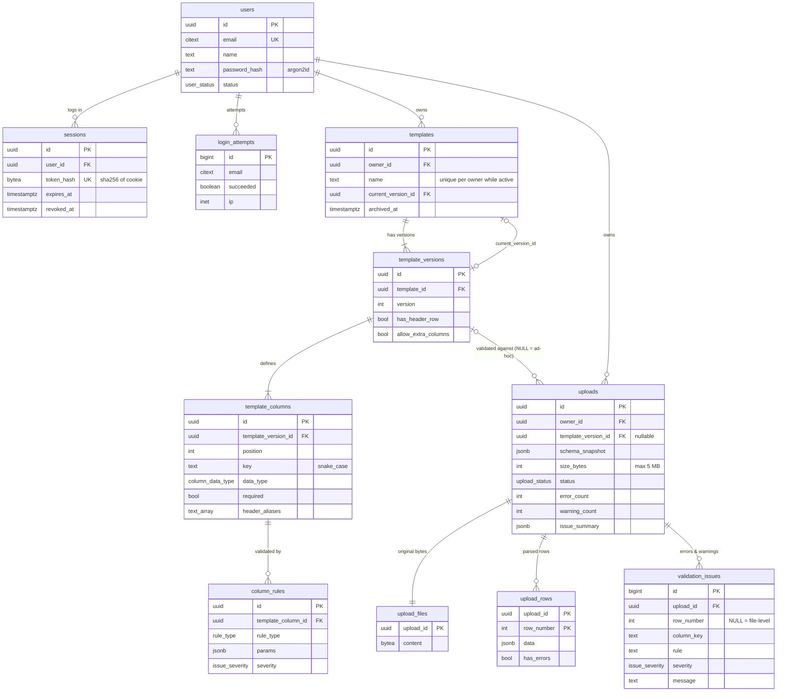

# DataDesk: Database design (Phase 1)

PostgreSQL 16, run in Docker. The schema lives in plain SQL migrations that the
[dbmate](https://github.com/amacneil/dbmate) container applies, so it is reviewable as SQL and does not
depend on the Node ORM chosen later.

| Path | What it is |
|---|---|
| `docker-compose.yml` | Postgres 16, a one-shot `migrate` container, and optional `seed`, `db-test` and `adminer` |
| `db/migrations/` | 4 migrations: `auth`, `templates`, `uploads`, `default_template` (each with `migrate:up` and `migrate:down`) |
| `db/seeds/dev_seed.sql` | Demo data: one user, 2 templates, 6 uploads covering every status (the ones shown in the mockups) |
| `db/tests/schema_tests.sql` | 52 tests checking that the database itself rejects invalid data |

## 1. Running it

```bash
cp .env.example .env                               # then set POSTGRES_PASSWORD
docker compose up -d                               # starts Postgres, applies migrations
docker compose --profile seed run --rm seed        # optional: demo data
docker compose --profile test run --rm db-test     # schema tests: prints "All schema tests passed."
docker compose --profile tools up -d adminer       # browse the DB at http://localhost:8080
```
Adding a migration: create `db/migrations/<yyyymmddhhmmss>_<name>.sql` with `-- migrate:up` and
`-- migrate:down` sections, then run `docker compose run --rm migrate up`. Migrations are forward-only
once merged. Never edit a migration that has already been applied to a shared environment.

**Verified here:** the migrations were applied and rolled back with dbmate 2.36 on PostgreSQL 16.
Up, down and up again are all clean. The seed and the 48 schema tests pass on both an empty and a
seeded database. The worker claim query was run by two sessions at once: the second took a different
upload without waiting for the first.
**Not verified here:** `docker compose up` itself, because Docker isn't available in this environment.
The compose file was checked against the Compose JSON schema. Running it is the first task of M0.

## 2. Decisions that shaped the schema

| Phase 1 decision | Effect on the schema |
|---|---|
| Personal templates only | `templates.owner_id` and nothing more. There are no organization or membership tables. Adding teams later means a new `organizations` table and an `org_id` column, with no rewrite. |
| Errors are downloaded and fixed outside the app, then the file is uploaded again as a **new entry** | Uploads never change after validation. There is no editing, re-validation or retry endpoint. `upload_rows` is read-only. |
| Max file size 5 MB | The original file is stored **in Postgres** (`upload_files.bytea`), so no S3 or MinIO is needed and the only containers are Postgres and Node. The limit is enforced in the browser, the API, and by DB `CHECK` constraints. |
| Node.js + Postgres | SQL-first migrations. The API can use `pg` + Kysely, or Drizzle in introspect mode. The job queue is a table (`SELECT … FOR UPDATE SKIP LOCKED`), so there's no Redis. |
| Normal login now, improvements later | Phase 1 has `users`, `sessions` and `login_attempts`. Password reset, email verification and SSO tables come in phase 2 (see §8). |

## 3. Entity-relationship diagram
GitHub renders the diagram below. A pre-rendered copy is in [`erd.png`](./erd.png).



## 4. Tables

### Login
| Table | Key points |
|---|---|
| `users` | `email citext UNIQUE`, so `Ann@X.com` and `ann@x.com` are the same account. Passwords must be at least 8 characters (checked in the API). `password_hash` holds an **argon2id** string with the salt inside it. `status` is `active`/`disabled`, so an account can be blocked without deleting its data. |
| `sessions` | The cookie holds a random 32-byte token and the DB stores only **SHA-256(token)**. Logout sets `revoked_at`. Expiry slides forward on activity (e.g. 14 days). Expired rows are deleted nightly. |
| `login_attempts` | Every attempt, including ones for unknown emails. The API refuses a login after **5 failures per email or per IP in 15 minutes**, and the table doubles as an audit trail. |

Login flow: look up the user by email (citext) → verify argon2id → insert into `login_attempts` →
insert a `sessions` row → set the cookie (`httpOnly; Secure; SameSite=Lax`). On each request, load the
user by `sha256(cookie)` where `revoked_at IS NULL AND expires_at > now() AND users.status = 'active'`.

### Templates
| Table | Key points |
|---|---|
| `templates` | Name is unique per user among active templates (case-insensitive). `is_default` (migration 004, M2): a partial unique index allows one default per user, archived templates can't be the default, and the default is preselected on upload. "Delete" in the UI **archives** the template, because uploads may still reference its versions. A hard delete is blocked by a foreign key. |
| `template_versions` | **Insert-only** (a trigger blocks UPDATE). Each Save inserts version N+1 with its columns and rules in one transaction, then moves `templates.current_version_id`. A composite foreign key guarantees the current version belongs to that same template. |
| `template_columns` | `key` is the stable snake_case identifier used in data and error reports. `display_name` is what users see. `header_aliases` drive auto-matching ("Ticket #" → `ticket_id`). The multi-value delimiter is required for, and only allowed on, `multiselect` columns. |
| `column_rules` | 7 declarative rule types (below), at most one of each per column. Severity is `error` or `warning`, with an optional custom message. `params` is checked with zod in the API, and its basic shape is also checked by a DB `CHECK`. |

| Rule | Params | Applies to |
|---|---|---|
| `min` / `max` | `{"value": 0}`, or for dates `{"value": "2020-01-01"}` | number, integer, date |
| `min_length` / `max_length` | `{"value": 500}` | text, email, url |
| `regex` | `{"pattern": "^\\+?[0-9 ()-]{7,20}$", "flags": "i"}` (run with RE2, so it can't hang) | text |
| `allowed_values` | `{"values": ["US","GB"], "case_sensitive": false}` | text, select, multiselect (each item) |
| `unique` | `{}` (whole-file check) | any |

`required` is a column flag, and the type check (is it a number, date, email…) comes from `data_type`.
Neither is stored as a rule.

### Uploads
| Table | Key points |
|---|---|
| `uploads` | One row per upload, and it never changes after validation finishes. `template_version_id` is NULL for ad-hoc uploads. `schema_snapshot` holds the exact columns, header mapping and rules used (§6). Counts and `issue_summary` are written once at the end. `CHECK` constraints keep the status consistent, e.g. `passed` requires 0 errors and 0 warnings, `failed_validation` requires at least 1 error, and `error` requires a message. `deleted_at` hides an upload from the list. |
| `upload_files` | The original bytes (≤ 5 MB), kept apart from `uploads` so list queries never read them. Used for "Download original". |
| `upload_rows` | Parsed rows as JSONB keyed by column `key`, with multi-value cells stored as arrays. These feed the read-only data view and the annotated download. |
| `validation_issues` | One row per failed check: row, column, rule, severity, message, and the raw value (cut to 500 characters). **File-level** problems, such as a missing required column or a duplicate header, have `row_number` and `column_key` NULL. At most **100,000** are stored per upload. Past that, `issues_truncated = true`, but the counts and `issue_summary` remain exact. |

## 5. Upload lifecycle and the worker

```
 API: POST /uploads ──► queued ──► validating ──┬─► passed
  (file + snapshot + bytes saved                ├─► passed_with_warnings
   in ONE transaction)                          ├─► failed_validation ──► user downloads errors,
                                                │                        fixes the file, uploads again
                                                └─► error (unreadable file, or 3 failed attempts)  = NEW upload
```

The worker is a Node process using the same image as the API, started with a different command.

1. **Claim** a job. `SKIP LOCKED` lets several workers run without taking the same upload, and an upload
   stuck in `validating` for more than 5 minutes (a crashed worker) is claimed again:
   ```sql
   UPDATE uploads SET status = 'validating', attempt = attempt + 1, locked_at = now(), validation_started_at = now()
   WHERE id = (SELECT id FROM uploads
               WHERE status = 'queued' OR (status = 'validating' AND locked_at < now() - interval '5 minutes')
               ORDER BY created_at FOR UPDATE SKIP LOCKED LIMIT 1)
   RETURNING id, schema_snapshot, attempt;
   ```
   If `attempt > 3`, set the status to `error` with a message instead of validating again.
2. **Validate** the file in memory (≤ 5 MB) with the shared rules package that the browser preview also uses.
3. **Finish in one transaction:** insert `upload_rows` and `validation_issues`, then set counts,
   `issue_summary`, the final status and `validation_finished_at`. A crash before the commit leaves no
   partial results, and the job is simply claimed again.

The listing and detail pages poll `GET /uploads/:id` every 2 seconds while the status is `queued` or `validating`.

## 6. `uploads.schema_snapshot` (the API ↔ worker contract)

Built by the API when the upload is created: either from the chosen template version plus the header
mapping the user confirmed, or entirely from the ad-hoc columns and rules set up in the upload screen.
```json
{
  "templateVersionId": "11000000-0000-4000-8000-000000000002",
  "hasHeaderRow": true,
  "allowExtraColumns": true,
  "columns": [
    { "key": "ticket_id", "name": "ticket_id", "type": "integer", "required": true, "delimiter": null,
      "aliases": ["Ticket #", "ticket id", "id"], "sourceIndex": 0, "sourceHeader": "Ticket #",
      "rules": [ { "type": "unique", "params": {}, "severity": "error" } ] },
    { "key": "confidence", "name": "confidence", "type": "number", "required": false, "delimiter": null,
      "aliases": ["score"], "sourceIndex": 4, "sourceHeader": "confidence",
      "rules": [ { "type": "min", "params": { "value": 0.6 }, "severity": "warning",
                   "message": "Low confidence: double-check the label" },
                 { "type": "max", "params": { "value": 1 }, "severity": "error" } ] }
  ]
}
```
`sourceIndex` is the 0-based position of the column in **this file** (`null` = not found), and `sourceHeader`
is the header as it appears there, which can differ from the template's name when matched through an alias.
The zod schema is `uploadSnapshotSchema` in `shared/src/upload.ts`; the API validates every snapshot against it
before saving, and the worker reads it with the same schema.

## 7. Error downloads (no storage needed: generated on request)

| Download | Built from | Contents |
|---|---|---|
| **Error report** `<name>_errors.csv` | `validation_issues` | `row, column, value, severity, problem`. File-level problems are listed first. |
| **Template format** `<name>_<template>.csv` | `upload_rows` + `schema_snapshot` | The "updated file as per schema": template columns in template order with template names, extra columns dropped, valid values normalised (dates → `YYYY-MM-DD`, booleans → `true`/`false`, numbers without currency signs or thousands separators, multi-values joined with the template delimiter). **Invalid values are exported unchanged.** |
| **File with errors marked** `<name>_annotated.csv` | the same, plus `validation_issues` | The template-format file plus a last column `__errors`, e.g. `confidence: "n/a" is not a number`. The user fixes it in Excel and uploads the same file again. The validator **always ignores** the `__errors` header. |
| **Original file** | `upload_files` | The exact bytes that were uploaded |

All CSV exports escape values that start with `= + - @` (CSV/formula injection).

## 8. Limits and what's deferred

| Limit | Value | Enforced in |
|---|---|---|
| File size | 5 MB (5,242,880 bytes) | browser, API body limit, `CHECK` on `uploads` and `upload_files` |
| Rows per file | **20,000** (decided) | browser pre-check, API (counts rows on upload), worker (file-level error). Kept in app config (`MAX_ROWS`) rather than a DB constraint, so the worker can still record the real row count in the error. |
| Stored issues per upload | 100,000 (counts always exact) | worker |
| Password length | at least 8 characters (decided) | API (zod) and the sign-up form |
| Login failures | 5 per email or IP per 15 minutes | API, using `login_attempts` |
| Session lifetime | 14 days, sliding | API |

**Phase 2 additions (no changes to existing tables):**
- `auth_tokens (user_id, purpose, token_hash, expires_at, used_at)` for password reset and email verification.
- `oauth_accounts` for Google/Microsoft sign-in. This also makes `users.password_hash` nullable.
- `organizations` + `memberships` for shared templates.
- `uploads.previous_upload_id`, to show "re-upload of …" in the list.
- A retention job that purges `upload_files` and `upload_rows` for uploads deleted more than 30 days ago.

## 9. Queries the Phase 1 screens need

```sql
-- Listing page (uses uploads_owner_created_idx / uploads_owner_status_idx)
SELECT u.id, u.name, u.original_filename, u.status, u.total_rows, u.error_count, u.warning_count, u.created_at,
       t.name AS template_name, tv.version
FROM uploads u
LEFT JOIN template_versions tv ON tv.id = u.template_version_id
LEFT JOIN templates t          ON t.id  = tv.template_id
WHERE u.owner_id = $1 AND u.deleted_at IS NULL
  AND ($2::upload_status IS NULL OR u.status = $2)
ORDER BY u.created_at DESC
LIMIT 25 OFFSET $3;

-- Detail page, "errors grouped by column": no aggregation needed, it's stored on the upload
SELECT issue_summary, error_count, warning_count, invalid_row_count, issues_truncated FROM uploads WHERE id = $1 AND owner_id = $2;

-- Detail page, issue table (paged, filterable by column)
SELECT row_number, column_key, rule, severity, message, raw_value
FROM validation_issues
WHERE upload_id = $1 AND ($2::text IS NULL OR column_key = $2)
ORDER BY row_number NULLS FIRST, column_key
LIMIT 50 OFFSET $3;
```
Every query filters on `owner_id = <session user>`. Checking ownership is the API's job, and M1 adds
tests that user A gets a 404 for user B's uploads and templates.
